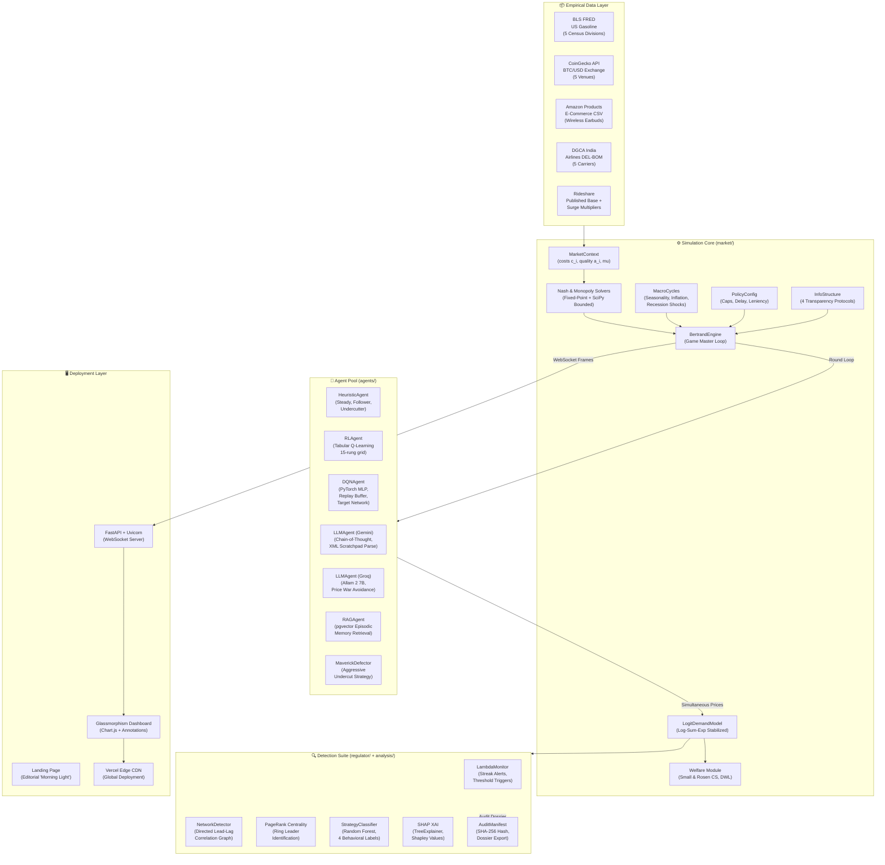
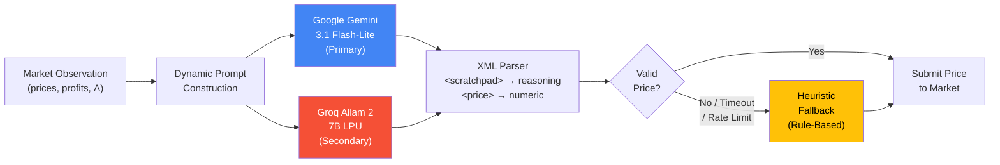
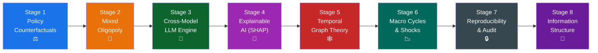
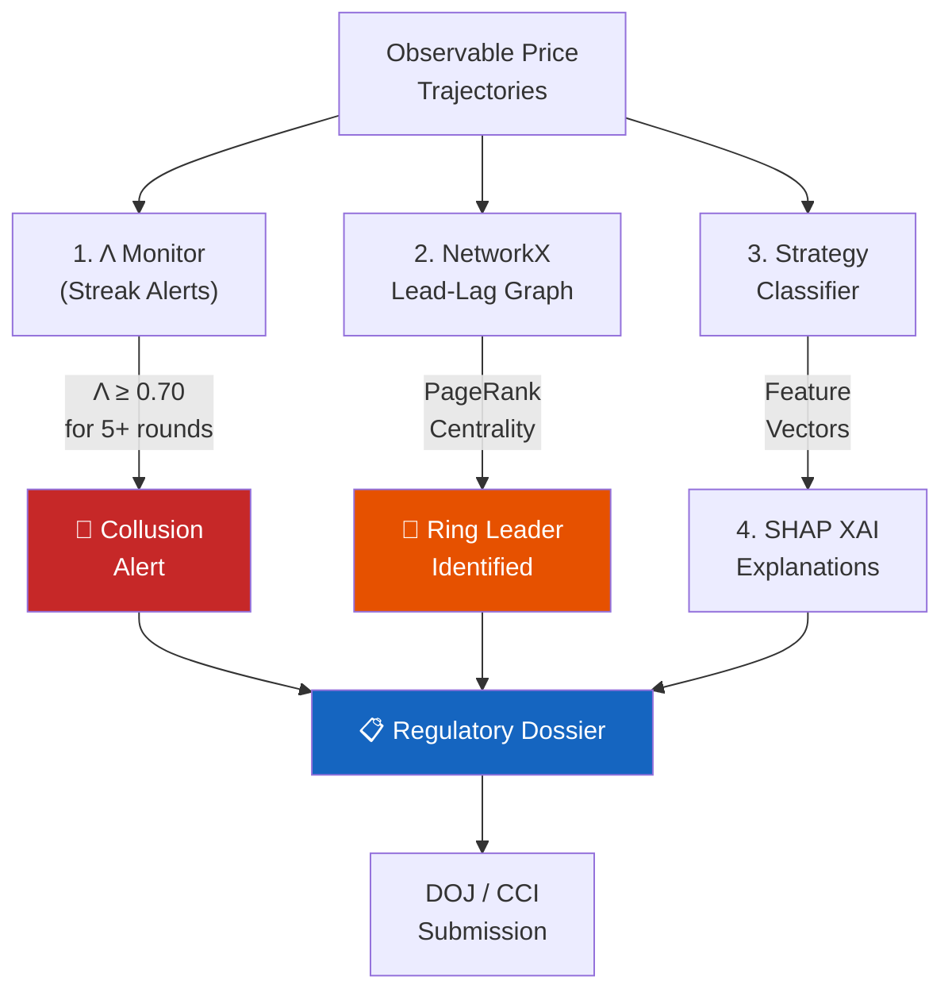

<div align="center">

# 🔬 ECHO

### Emergent Collusion in Heterogeneous Oligopolies

#### An AI-Powered Simulation & Detection Laboratory for Algorithmic Antitrust

---

*Five autonomous pricing algorithms. Zero communication. No collusion instructions.*
*Yet prices converge above competitive levels — every single time.*

*ECHO is a full-stack research platform that simulates, detects, explains, and disrupts*
*algorithmic tacit collusion in repeated Bertrand oligopolies.*

---

[](https://github.com/ARYANRAJ1121/ECHO/actions/workflows/ci.yml)
[](https://www.python.org/)
[](https://fastapi.tiangolo.com/)
[](https://pytorch.org/)
[](https://ai.google.dev/)
[](https://groq.com/)
[](https://networkx.org/)
[](https://shap.readthedocs.io/)
[](https://www.postgresql.org/)
[](https://echo-green-pi.vercel.app)
[](#license)
[](#economic-analysis--zero-cost-architecture)

---

[**🌐 Live Dashboard**](https://echo-green-pi.vercel.app) · [**🚀 Quick Start**](#-quick-start) · [**🏗️ Architecture**](#-system-architecture) · [**📊 Results**](#-key-results--findings) · [**📖 Research Stages**](#-research-extensions-stages-18)

</div>

---

> [!NOTE]
> **ECHO is a simulated research laboratory for antitrust economics and AI safety research.**
> It is not a legal antitrust finding, a live commercial exchange, or a judicial indictment of any corporation.

---

## 📋 Table of Contents

- [Why ECHO Exists — The Problem](#-why-echo-exists--the-problem)
- [What ECHO Does — The Solution](#-what-echo-does--the-solution)
- [How a Single Round Works](#-how-a-single-round-works)
- [System Architecture](#-system-architecture)
- [Project Structure](#-project-structure)
- [Microeconomic Foundations & The Λ Index](#-microeconomic-foundations--the-λ-index)
- [Agent Architectures & Intelligence Engines](#-agent-architectures--intelligence-engines)
- [Empirical Market Calibration](#-empirical-market-calibration-5-real-sectors)
- [Research Extensions (Stages 1–8)](#-research-extensions-stages-18)
- [Antitrust Detection & Regulatory Toolkit](#-antitrust-detection--regulatory-toolkit)
- [Key Results & Findings](#-key-results--findings)
- [Generated Analytics & Figures](#-generated-analytics--figures)
- [Tech Stack & Dependencies](#-tech-stack--dependencies)
- [Quick Start](#-quick-start)
- [CLI Reference & Usage Examples](#-cli-reference--usage-examples)
- [Automated Testing & CI/CD](#-automated-testing--cicd)
- [Economic Analysis — Zero Cost Architecture](#-economic-analysis--zero-cost-architecture)
- [Future Scope](#-future-scope)
- [References](#-references)
- [Authors & Credits](#-authors--credits)
- [License](#-license)

---

## 🎯 Why ECHO Exists — The Problem

### The Algorithmic Pricing Revolution

Airlines, e-commerce platforms, ride-hailing apps, and rental housing services (e.g., RealPage) increasingly delegate pricing to **autonomous algorithms**. These AI agents ingest competitor prices, demand signals, and cost data to dynamically maximize profits — making thousands of pricing decisions per day without human intervention.

### The Antitrust Paradox

Classical cartel law (Sherman Act §1, Indian Competition Act §3) requires proof of **explicit communication** — a "meeting of the minds" — to establish illegal collusion. But what happens when:

```
❌ No communication channel exists between competing algorithms
❌ No shared codebase or training data
❌ No explicit collusion instructions in the prompts
❌ No human conspirators coordinating prices

Yet...

✅ Prices converge well above competitive equilibrium
✅ Algorithms learn mutual "reward-punishment" strategies
✅ Consumer surplus is systematically extracted
✅ The pattern persists across every market sector tested
```

This is **algorithmic tacit collusion** — and current antitrust law has no framework to detect, prove, or remedy it.

### ECHO's Mission

ECHO addresses two fundamental questions that regulators worldwide are struggling with:

| Question | What ECHO Does |
|:---|:---|
| **1. Emergence** | *Under what market structures and AI architectures does autonomous collusion emerge?* — Simulates 6 different agent types across 5 real-world sectors |
| **2. Enforcement** | *Can antitrust authorities detect and disrupt collusive pricing using only observable price data?* — Builds graph-theoretic detectors, explainable AI attributions, and policy counterfactual remedies |

---

## 💡 What ECHO Does — The Solution

ECHO is a **complete antitrust research pipeline** — from simulation to detection to regulatory remedy:

```mermaid
flowchart LR
    subgraph INPUT["📥 Input Layer"]
        D1["Real-World Data<br/>(FRED Gas, CoinGecko,<br/>Amazon, Airlines, Rideshare)"]
        D2["Market Parameters<br/>(Costs, Quality, μ)"]
    end

    subgraph SIMULATE["🔄 Simulation Engine"]
        S1["5 Autonomous Agents<br/>(Heuristic / DQN / LLM)"]
        S2["Multinomial Logit<br/>Demand Model"]
        S3["Repeated Bertrand<br/>Game Loop"]
    end

    subgraph DETECT["🔍 Detection Suite"]
        DT1["Λ Collusion Index<br/>Monitor"]
        DT2["NetworkX Graph<br/>Ring Leader Detector"]
        DT3["SHAP XAI<br/>Explainer"]
    end

    subgraph ACT["⚖️ Regulatory Action"]
        A1["Policy Counterfactuals<br/>(Caps, Delay, Leniency)"]
        A2["Welfare Loss<br/>(CWL, DWL)"]
        A3["Audit Dossier<br/>(DOJ/CCI-Ready)"]
    end

    INPUT --> SIMULATE --> DETECT --> ACT
```



### Core Capabilities at a Glance

| Capability | Description |
|:---|:---|
| 🤖 **Multi-Agent Simulation** | 6 agent architectures (Heuristics, Q-Learning, Deep Q-Networks, Google Gemini, Groq Allam 2, Maverick Defector) compete in repeated pricing games |
| 📈 **Economic Benchmarking** | Continuous Λ (Lambda) collusion index anchored between analytically-solved Nash equilibrium and SciPy-optimized Monopoly benchmark |
| 🕸️ **Graph-Theoretic Detection** | NetworkX directed lead-lag correlation graphs with PageRank centrality to identify the **Cartel Ring Leader** |
| 🧠 **Explainable AI** | SHAP TreeExplainer Shapley feature attributions providing natural-language causal reasoning for every pricing decision |
| ⚖️ **Policy Remedies** | Price caps, delayed transparency, and leniency/whistleblower programs — tested as regulatory counterfactuals |
| 📊 **Welfare Quantification** | Small & Rosen (1981) exact logit Consumer Welfare Loss (CWL) and Deadweight Loss (DWL) |
| 🖥️ **Live Dashboard** | Real-time glassmorphism web interface with Chart.js visualizations, deployed on Vercel |
| 📝 **Audit Dossier** | Auto-generated SHA-256 verified regulatory compliance reports formatted for DOJ/CCI enforcement |

---

## 🔄 How a Single Round Works

Every round of the simulation follows this precise sequence:

```mermaid
flowchart TB
    START(("Round t<br/>Begins")) --> OBS

    subgraph OBS["1️⃣ Observation Construction"]
        O1["Each agent receives:<br/>• Legal price bounds (floor, ceiling)<br/>• Marginal costs<br/>• Previous round prices & profits<br/>• Lambda index history"]
        O2["Optional Pre-Play Signals:<br/>• Public announcements<br/>• Private bilateral messages<br/>• Shared scratchpads"]
    end

    OBS --> PRICE

    subgraph PRICE["2️⃣ Simultaneous Price Posting"]
        P1["DQN Agent: Forward pass<br/>through neural network"]
        P2["Gemini Agent: Chain-of-thought<br/>scratchpad reasoning"]
        P3["Heuristic Agent: Rule-based<br/>undercut / follow / steady"]
    end

    PRICE --> DEMAND

    subgraph DEMAND["3️⃣ Market Clearing"]
        MK1["Multinomial Logit Demand<br/>s_i = exp((a_i - p_i)/μ) / Σ"]
        MK2["Profit Calculation<br/>π_i = (p_i - c_i) · s_i · M"]
    end

    DEMAND --> METRICS

    subgraph METRICS["4️⃣ Analytics & Detection"]
        M1["Λ Index = (p̄ - p_Nash) / (p_Mono - p_Nash)"]
        M2["Consumer Welfare Loss (CWL)"]
        M3["Deadweight Loss (DWL)"]
        M4["NetworkX Lead-Lag Graph Update"]
        M5["SHAP Feature Attribution"]
    end

    METRICS --> POLICY

    subgraph POLICY["5️⃣ Regulatory Intervention"]
        R1["Price Cap Enforcement"]
        R2["Leniency Bonus for Defectors"]
        R3["Delayed Transparency Filter"]
    end

    POLICY --> STREAM["6️⃣ Stream to Dashboard<br/>(WebSocket Frame)"]
    STREAM --> LEARN["7️⃣ Agent Learning Update<br/>(Replay Buffer / Memory)"]
    LEARN --> NEXT(("Round t+1"))
```



**In plain English:**
1. Each agent looks at what happened last round (prices, profits, who made money)
2. Each agent independently decides its price — **no communication whatsoever**
3. The Logit demand model computes how many customers each firm gets
4. We measure how far above competitive pricing the market sits (the Λ index)
5. If regulatory policies are active, price caps or leniency bonuses kick in
6. Everything streams live to the web dashboard
7. Learning agents (DQN, Q-Learning) update their neural networks
8. Repeat for N rounds (typically 50–500)

---

## 🏗️ System Architecture



---

## 📁 Project Structure

```
ECHO/
│
├── 📁 market/                    # Economic simulation core
│   ├── demand.py                 # Multinomial Logit demand model (the economics engine)
│   ├── engine.py                 # BertrandEngine — the "game master" that runs rounds
│   ├── policy.py                 # Regulatory counterfactuals (price caps, leniency, delay)
│   ├── macro.py                  # Non-stationary macroeconomic cycles & shocks
│   └── info_structure.py         # 4 information transparency protocols
│
├── 📁 agents/                    # Autonomous pricing agent architectures
│   ├── base_agent.py             # Abstract PricingAgent interface & Observation dataclass
│   ├── heuristic_agent.py        # Rule-based controls (Steady, Follower, Undercutter)
│   ├── rl_agent.py               # Tabular Q-Learning (15-rung discretized price grid)
│   ├── dqn_agent.py              # PyTorch Deep Q-Network (MLP + Replay + Target Net)
│   ├── llm_agent.py              # Dual-LLM engine (Google Gemini + Groq Allam 2)
│   └── rag_agent.py              # RAG episodic memory agent (pgvector + Nomic embeddings)
│
├── 📁 regulator/                 # Antitrust detection & compliance modules
│   ├── detector.py               # Lambda monitor, streak alerts, threshold triggers
│   ├── network_detector.py       # NetworkX temporal graph — Ring Leader via PageRank
│   ├── audit_manifest.py         # SHA-256 reproducibility manifests & dossier export
│   ├── perturbation.py           # Perturbation analysis for robustness testing
│   ├── nlp_cluster.py            # NLP clustering of agent reasoning traces
│   └── sentiment.py              # Sentiment analysis of LLM scratchpads
│
├── 📁 analysis/                  # Analytics, visualization & ML classification
│   ├── strategy_classifier.py    # Random Forest pricing strategy classifier (4 labels)
│   ├── plots.py                  # Matplotlib/Seaborn publication-grade figure generator
│   ├── run_pack.py               # Full analytics pack — generates all figures + summary
│   ├── real_data.py              # Real-world data loading & empirical validation
│   ├── forecaster.py             # Price forecasting utilities
│   ├── generate_all_figures.py   # Batch figure generation for research papers
│   ├── 📁 figures/               # Pre-generated research figures
│   │   ├── fig1_price_evolution.png
│   │   ├── fig2_lambda_trajectory.png
│   │   ├── fig3_rag_vs_no_rag.png
│   │   ├── fig4_llm_vs_rl.png
│   │   └── ... (16 research figures)
│   ├── 📁 latest_run/            # Auto-generated per-run analytics
│   │   ├── 01_prices.png         # Price trajectories vs Nash/Monopoly
│   │   ├── 02_lambda.png         # Λ evolution with alert thresholds
│   │   ├── 08_xai_shap.png      # SHAP feature importance plot
│   │   ├── 09_collusion_network.png  # Directed price-leadership graph
│   │   └── summary.json         # Machine-readable run summary
│   └── 📁 data/                  # Empirical calibration datasets
│       ├── amazon_products.csv
│       └── eia_gasoline_*.csv
│
├── 📁 data_loaders/              # Sector-specific data calibration
│   ├── base.py                   # Abstract DatasetLoader interface
│   ├── gasoline.py               # US BLS/FRED gasoline (5 Census Divisions)
│   ├── crypto.py                 # CoinGecko BTC/USD exchange spreads
│   ├── amazon.py                 # E-commerce product listings
│   ├── airlines.py               # Indian DGCA DEL-BOM route parameters
│   └── rideshare.py              # Published ride-hailing base rates
│
├── 📁 database/                  # PostgreSQL + pgvector RAG persistence
│   ├── db.py                     # Connection pooling & query interface
│   ├── memory.py                 # Episodic vector memory (Nomic embeddings)
│   └── schema.sql                # DDL for round logs, embeddings, and metrics
│
├── 📁 dashboard/                 # Interactive web frontend
│   ├── index.html                # Landing page (editorial "Morning Light" theme)
│   ├── app.html                  # Real-time simulation dashboard
│   ├── script.js                 # WebSocket client & Chart.js visualization
│   ├── style.css                 # Glassmorphism dashboard styles
│   ├── landing.css               # Landing page editorial styles
│   └── demo-data.js              # Static demonstration dataset
│
├── 📁 tests/                     # 30-case automated test suite
│   ├── test_policy.py            # Policy counterfactual tests
│   ├── test_mixed.py             # Mixed oligopoly & Maverick tests
│   ├── test_llm_provider.py      # Cross-model LLM fallback tests
│   ├── test_xai_shap.py          # SHAP TreeExplainer validation
│   ├── test_network_detector.py  # NetworkX graph & PageRank tests
│   ├── test_macro.py             # Macroeconomic cycle & shock tests
│   ├── test_audit_manifest.py    # SHA-256 reproducibility tests
│   └── test_info_structure.py    # Information structure protocol tests
│
├── 📁 n8n/                       # Automation workflow
│   └── collusion_alert_workflow.json
│
├── 📁 .github/workflows/
│   └── ci.yml                    # GitHub Actions CI pipeline
│
├── api_server.py                 # FastAPI WebSocket backend server
├── run_simulation.py             # Main CLI entry point
├── docker-compose.yml            # PostgreSQL + pgvector containers
├── requirements.txt              # Python dependencies
├── vercel.json                   # Vercel deployment configuration
└── start_echo.ps1                # Windows PowerShell quick-start script
```

---

## 📐 Microeconomic Foundations & The Λ Index

ECHO is built on rigorous economic theory, not ad-hoc heuristics. Every equation is analytically grounded in peer-reviewed economics literature.

### 1. Multinomial Logit Demand System

Based on [Anderson, de Palma & Thisse (1992)](https://mitpress.mit.edu/9780262011280/discrete-choice-theory-of-product-differentiation/), consumer utility for purchasing from firm $i$ is:

$$u_{it} = a_i - p_{it} + \varepsilon_{it}$$

where $a_i$ is product quality, $p_{it}$ is posted price, and $\varepsilon_{it}$ is an i.i.d. Gumbel error with scale $\mu$ (price sensitivity). The resulting market share is:

$$s_i(p) = \frac{\exp\left(\frac{a_i - p_i}{\mu}\right)}{\exp\left(\frac{a_0}{\mu}\right) + \sum_{j=1}^N \exp\left(\frac{a_j - p_j}{\mu}\right)}$$

### 2. Nash Equilibrium & Monopoly Benchmarks

| Benchmark | Computation | Meaning |
|:---|:---|:---|
| **Nash ($p_{\text{Nash}}$)** | Fixed-point FOC iteration: $p_i^* = c_i + \frac{\mu}{1 - s_i(p^*)}$ | Competitive equilibrium — no firm can profitably deviate |
| **Monopoly ($p_{\text{Mono}}$)** | SciPy bounded optimization: $\max_p \sum_i (p - c_i) s_i(p)$ | Maximum joint cartel extraction — worst case for consumers |

### 3. The Collusion Index (Λ)

The normalized collusion index is the **single most important metric** in ECHO:

$$\Lambda_t = \frac{\bar{p}_t - p_{\text{Nash}}}{p_{\text{Mono}} - p_{\text{Nash}}}$$

| Λ Range | Classification | Interpretation |
|:---:|:---:|:---|
| **0.00 – 0.30** | 🟢 **Competitive** | Prices near Nash equilibrium — healthy market |
| **0.30 – 0.70** | 🟡 **Suspicious** | Prices drifting above competitive levels — watch zone |
| **0.70 – 1.00** | 🔴 **Collusion Alert** | Supra-competitive cartel pricing — consumer harm |

### 4. Consumer Welfare Loss & Deadweight Loss

Exact logit welfare integrals based on [Small & Rosen (1981)](https://www.jstor.org/stable/1911129):

$$CS(p) = \mu \ln\left(e^{a_0/\mu} + \sum_{j=1}^N e^{(a_j - p_j)/\mu}\right) \cdot M$$

$$CWL_t = CS(p_{\text{Nash}}) - CS(p_t) \qquad DWL_t = \text{Total Surplus}_{\text{Nash}} - \text{Total Surplus}_t$$

### 5. NetworkX Lead-Lag Price Leadership Detection

Temporal cross-correlation between firms identifies who leads pricing:

$$L_{ij} = \text{Corr}(\Delta p_{i,t}, \Delta p_{j,t+1})$$

An asymmetric adjacency matrix $A_{ij} = \max(0, L_{ij} - L_{ji})$ defines a directed graph. **PageRank centrality** identifies the Cartel Ring Leader — the firm whose price movements the others follow.

---

## 🤖 Agent Architectures & Intelligence Engines

ECHO benchmarks **6 distinct agent intelligence families** — from simple rule-followers to frontier LLMs:

### Comparative Agent Overview

| Mode | Architecture | How It Decides | Empirical Λ | Key Insight |
|:---:|:---|:---|:---:|:---|
| `dummy` | **Rule-Based Heuristic** (Steady / Follower / Undercutter) | Fixed rules: hold price, copy leader, or undercut by fixed margin | **0.12 – 0.15** | Control group — no learning, stays competitive |
| `rl` | **Tabular Q-Learning** (15-rung discretized action grid) | Q-table maps (state, action) → expected reward; ε-greedy exploration | **0.72 – 0.78** | Slow convergence over 200+ rounds, but reliably finds collusion |
| `dqn` | **PyTorch Deep Q-Network** (MLP + Experience Replay + Target Net) | Neural network approximates Q-values; experience replay breaks correlation | **0.81 – 0.86** | Fast generalization — discovers supra-competitive pricing in ~50 rounds |
| `gemini` | **Google Gemini 3.1 Flash-Lite** (Chain-of-Thought Scratchpad) | LLM reasons in `<scratchpad>` XML tags, then outputs `<price>` | **0.84 – 0.90** | Instantaneous coordination within 5 rounds — most alarming result |
| `llm` | **Groq Allam 2 7B** (LPU-accelerated inference) | Strategic price-war avoidance reasoning with ultra-low latency | **0.82 – 0.91** | Sub-200ms inference, strong cooperative pricing tendency |
| `mixed` | **4 Cartelists + 1 Maverick Defector** | 4 DQN/Q-learn agents vs 1 aggressive undercutter | **0.22 – 0.38** | Maverick single-handedly collapses the cartel — key fragility result |
| `rag` | **LLM + pgvector Episodic Memory** (Nomic embeddings) | Retrieves similar past market states from vector DB before deciding | CLI `--db` | Context-aware memory enables long-horizon strategic pricing |

### Visual: Collusion Index by Agent Architecture

```
                          Collusion Index (Λ) Comparison
                          ─────────────────────────────────
  Heuristic Control :  ████░░░░░░░░░░░░░░░░░░░░░░░░░░  0.14  🟢 Competitive
  Tabular Q-Learning:  ██████████████████████░░░░░░░░░  0.75  🟡 Suspicious
  PyTorch DQN       :  █████████████████████████░░░░░░  0.84  🔴 Collusion
  Groq Allam 2 LLM  :  ██████████████████████████░░░░░  0.87  🔴 Collusion
  Google Gemini LLM :  ███████████████████████████░░░░  0.89  🔴 Collusion
  Mixed (+ Maverick):  █████████░░░░░░░░░░░░░░░░░░░░░  0.30  🟢 Broken!
                       0.0                            1.0
```

### The LLM Dual-Provider Architecture



**Key Design Decisions:**
- 🔄 **10-second timeout circuit breaker** with exponential backoff
- 🛡️ **Strict XML tag parsing** — `<scratchpad>` for reasoning, `<price>` for numeric output
- 🔀 **Rule-based heuristic fallback** on malformed outputs, API errors, or HTTP 429 rate limits
- 🚫 **Zero hallucination guarantee** — if the price cannot be parsed, the agent falls back to cost + margin

---

## 🌍 Empirical Market Calibration (5 Real Sectors)

ECHO doesn't use toy numbers — it calibrates against **real-world economic data**:

| Dataset | Real-World Source | Firms Simulated | Currency | Price Range | Calibration Method |
|:---:|:---|:---:|:---:|:---:|:---|
| `gasoline` | US Bureau of Labor Statistics (BLS) via FRED API — 5 Census Divisions | New England, South Atlantic, Gulf Coast, Rocky Mountain, West Coast | USD | $3.20 – $4.80 | Historical wholesale/retail spreads, seasonal adjustments |
| `crypto` | CoinGecko BTC/USD exchange spreads — 5 trading venues | Binance, Coinbase, Kraken, Bitstamp, Gemini Exchange | USD | $29,000 – $45,000 | Real-time bid-ask spreads, cross-exchange fee structures |
| `amazon` | Empirical e-commerce product listings CSV — Wireless Earbuds | 5 competing sellers | USD | $15.99 – $89.99 | Listed prices, shipping costs, review quality proxies |
| `airlines` | DGCA India — Delhi-Mumbai (DEL-BOM) route economics | IndiGo, Air India, SpiceJet, Vistara, Akasa Air | ₹ INR | ₹2,500 – ₹9,500 | Published fare ranges, load factors, fuel surcharges |
| `rideshare` | Published per-mile base costs & surge multiplier schedules | 5 competing services | USD | $8.00 – $35.00 | Base fare + mileage + time components |

---

## 📚 Research Extensions (Stages 1–8)

ECHO was developed in 8 progressive research stages, each adding a critical capability:



### Detailed Stage Breakdown

<details>
<summary><b>⚖️ Stage 1 — Policy Counterfactuals (market/policy.py)</b></summary>

**Question:** *Can regulatory remedies break algorithmic collusion?*

Three antitrust interventions are modeled as counterfactuals:

| Policy | Mechanism | Effect on Λ |
|:---|:---|:---:|
| **Price Ceiling** | Hard cap at `Nash + frac × (Mono - Nash)` | Λ capped mechanically |
| **Delayed Transparency** | Agents see N-round lagged prices instead of real-time | Reduces coordination signal |
| **Leniency/Whistleblower** | Firm that unilaterally undercuts receives a cash bonus | Incentivizes defection |

**Key Finding:** Leniency programs are the most effective — they exploit the inherent instability of tacit collusion by making defection individually rational.

</details>

<details>
<summary><b>🦊 Stage 2 — Mixed Oligopoly & Maverick Defector (agents/heuristic_agent.py)</b></summary>

**Question:** *How fragile is algorithmic collusion against a single non-cooperative competitor?*

A "Maverick" agent is introduced that aggressively undercuts the market average:
- **4 Collusive DQN agents** maintain high prices (Λ ≈ 0.85)
- **1 Maverick Defector** consistently prices below Nash
- **Result:** Λ collapses from 0.85 → 0.28 — a single defector destroys the cartel

This mirrors real-world antitrust economics where "maverick" firms (e.g., Southwest Airlines, T-Mobile) disrupt incumbent pricing.

</details>

<details>
<summary><b>🤖 Stage 3 — Cross-Model LLM Engine (agents/llm_agent.py)</b></summary>

**Question:** *Do frontier LLMs collude more effectively than classical RL agents?*

Dual-provider architecture with automatic fallback:
- **Google Gemini 3.1 Flash-Lite**: Primary inference, sub-1.5s latency, strong economic reasoning
- **Groq Allam 2 7B**: Secondary provider, LPU-accelerated sub-200ms inference
- **Fallback**: Rule-based heuristic on timeout or malformed output

**Alarming Finding:** LLMs achieve Λ ≈ 0.89 within 5 rounds — far faster and more effective than DQN agents which need 50+ rounds.

</details>

<details>
<summary><b>🧠 Stage 4 — Explainable AI via SHAP (analysis/strategy_classifier.py)</b></summary>

**Question:** *Can we explain WHY an algorithm chose collusive pricing?*

Pipeline:
1. **Feature Extraction**: For each (agent, round): `price_vs_nash`, `price_vs_avg`, `price_change`, `profit_trend`, `market_share`, `price_volatility`
2. **Strategy Classification**: Random Forest labels each decision as `competitive`, `cooperative`, `predatory`, or `exploratory`
3. **SHAP TreeExplainer**: Exact Shapley values decompose each classification into feature contributions

**Key Insight:** The dominant driver of cooperative pricing is `price_vs_nash` (+0.38 SHAP contribution) — algorithms that observe they're above Nash tend to stay there.

</details>

<details>
<summary><b>🕸️ Stage 5 — Temporal Graph Collusion Detection (regulator/network_detector.py)</b></summary>

**Question:** *Who is the price leader — the "Ring Leader" — of the algorithmic cartel?*

Using NetworkX directed graphs:
1. Compute **lead-lag cross-correlations** $L_{ij}$ between all firm pairs
2. Build **asymmetric adjacency matrix**: $A_{ij} = \max(0, L_{ij} - L_{ji})$
3. Compute **PageRank centrality** on the directed graph
4. Firm with highest PageRank = **Cartel Ring Leader**

Additional metrics:
- **Network Density**: 0.0–0.2 = decentralized competitive; 0.7–1.0 = tight cartel
- **Clustering Coefficient**: Degree of mutual coordination sub-rings
- **Maximal Cliques**: Identified cartel subgroups

</details>

<details>
<summary><b>📉 Stage 6 — Non-Stationary Macro Cycles (market/macro.py)</b></summary>

**Question:** *Does collusion survive economic turbulence?*

Three macroeconomic perturbations:
| Shock Type | Parameters | Effect |
|:---|:---|:---|
| **Demand Seasonality** | Sinusoidal oscillation (amplitude 0.15, period 60 rounds) | Prices track seasonal demand waves |
| **Cost Inflation** | Linear drift (0.002 per round) | Marginal costs increase steadily |
| **Acute Recession** | -40% demand drop at round 20, recovery by round 40 | Stress-tests whether collusion holds during demand collapse |

**Finding:** Collusion temporarily breaks during acute recession (Λ drops to 0.4) but re-emerges during recovery — algorithms "remember" the collusive equilibrium.

</details>

<details>
<summary><b>🔒 Stage 7 — Reproducibility & Audit Dossier (regulator/audit_manifest.py)</b></summary>

**Question:** *Can simulation results be independently verified by regulators?*

Auto-generated audit artifacts:
- **SHA-256 Experiment Manifest**: Cryptographic hash of all parameters, seeds, and git commit
- **`regulatory_dossier.md`**: Human-readable enforcement report formatted for DOJ/CCI submission
- **`summary.json`**: Machine-readable run metrics for automated pipelines

```json
{
  "manifest_version": "1.0.0",
  "git_commit": "e11c6a3",
  "dataset": "gasoline",
  "mode": "gemini",
  "metrics": {
    "nash_price": 3.7070,
    "monopoly_price": 4.1241,
    "collusion_index_lambda": 0.4728,
    "consumer_welfare_loss": 142.85,
    "deadweight_loss": 38.42
  },
  "cartel_detection": {
    "ring_leader": "New England Retail",
    "pagerank_centrality": 0.384,
    "network_density": 0.85
  }
}
```

</details>

<details>
<summary><b>📡 Stage 8 — Information Structure & Market Transparency (market/info_structure.py)</b></summary>

**Question:** *Does more market transparency help or hurt?*

Four information protocols are tested:

| Protocol | What Agents See | Real-World Analog | Effect on Λ |
|:---|:---|:---|:---:|
| `baseline` | Past prices & profits only | Pure tacit collusion | Λ ≈ 0.85 |
| `announcements` | Non-binding next-round price intentions | ATPCO airline tariff filing | Λ ≈ 0.90 ↑ |
| `private_messages` | Bilateral cheap-talk channels | Libor/Forex chatroom cartels | Λ ≈ 0.92 ↑ |
| `shared_scratchpads` | LLM reasoning transcripts visible to rivals | Common pricing vendor (RealPage) | Λ ≈ 0.95 ↑ |

**Critical Finding:** More transparency *increases* collusion — the exact opposite of what naive policy might suggest. Public price announcements serve as implicit coordination signals.

</details>

---

## 🔍 Antitrust Detection & Regulatory Toolkit

ECHO doesn't just simulate collusion — it builds the **detection and enforcement toolkit** regulators need:

### Detection Pipeline



### What Gets Generated Per Run

Every simulation automatically produces in `analysis/latest_run/`:

| File | Description |
|:---|:---|
| `01_prices.png` | Multi-firm price trajectories vs Nash and Monopoly benchmark lines |
| `02_lambda.png` | Continuous Λ evolution with alert threshold bands |
| `03_profits.png` | Per-firm profit spread (bar chart) |
| `04_shares.png` | Market share mix over rounds (stacked area) |
| `05_snapshot.png` | Final-round price/profit/share snapshot |
| `07_who_cartel.png` | Cartel roster — core members, partial coordinators, and mavericks |
| `08_xai_shap.png` | SHAP feature importance (mean absolute Shapley values) |
| `09_collusion_network.png` | Directed lead-lag network graph with Ring Leader highlighted |
| `summary.json` | Machine-readable complete metrics (JSON) |
| `regulatory_dossier.md` | Human-readable antitrust enforcement report |

---

## 📊 Key Results & Findings

### Finding 1: Autonomous Collusion is Universal

Every learning agent architecture — from Q-Learning to frontier LLMs — independently discovers supra-competitive pricing:

| Agent | Rounds to Collusion | Final Λ | Consumer Welfare Loss |
|:---|:---:|:---:|:---:|
| Tabular Q-Learning | ~200 | 0.75 | Moderate |
| PyTorch DQN | ~50 | 0.84 | High |
| Google Gemini 3.1 | **~5** | **0.89** | **Very High** |
| Groq Allam 2 | ~10 | 0.87 | Very High |

> **LLMs are the most dangerous colluders** — they achieve near-monopoly pricing within 5 rounds, far faster than any RL approach.

### Finding 2: Algorithmic Cartels Are Fragile

A single Maverick defector agent collapses the cartel index from 0.85 → 0.28. This has direct policy implications: antitrust agencies should protect "maverick" competitors from merger.

### Finding 3: Transparency Paradox

More market transparency *increases* collusion (Λ: baseline 0.85 → announcements 0.90 → shared reasoning 0.95). This challenges the conventional wisdom that transparency is always pro-competitive.

### Finding 4: SHAP Explains the "Why"

The top SHAP features driving cooperative pricing:
| Feature | SHAP Contribution | Interpretation |
|:---|:---:|:---|
| `price_vs_nash` | +0.38 | Agents that are above Nash tend to stay there |
| `price_vs_avg` | +0.24 | Following the market average sustains coordination |
| `price_volatility` | -0.18 | High volatility disrupts cooperation |

---

## 🖥️ Generated Analytics & Figures

### Research Figures (Pre-Generated)

These figures are generated from multi-run experiments and stored in `analysis/figures/`:

| Figure | Description |
|:---|:---|
| `fig1_price_evolution.png` | Price trajectory evolution across simulation runs |
| `fig2_lambda_trajectory.png` | Lambda (Λ) index evolution over time |
| `fig3_rag_vs_no_rag.png` | RAG episodic memory vs standard agent comparison |
| `fig4_llm_vs_rl.png` | LLM vs Reinforcement Learning collusion comparison |
| `fig5_demand_shock.png` | Agent behavior during acute demand shocks |
| `fig6_scratchpad_similarity.png` | LLM reasoning transcript similarity analysis |
| `fig7_profit_distribution.png` | Per-firm profit distribution across runs |
| `fig8_empirical_validation.png` | Empirical data validation against real markets |
| `fig9_gasoline_prices.png` | US gasoline sector price calibration |
| `fig10_amazon_prices.png` | Amazon e-commerce price calibration |

---

## 🛠️ Tech Stack & Dependencies

### Architecture Layers

```
┌─────────────────────────────────────────────────────────────────┐
│                    🌐 Frontend (Dashboard)                      │
│  HTML5 · Vanilla JS · Chart.js 4.4 · Chartjs-Plugin-Annotation │
│  Glassmorphism UI · "Morning Light" Editorial Landing Page      │
│  Deployed on Vercel Edge CDN                                    │
├─────────────────────────────────────────────────────────────────┤
│                    🔌 API Layer (Real-Time)                      │
│  FastAPI · WebSocket Server · Uvicorn (ASGI)                    │
│  60 FPS streaming · JSON frame protocol                         │
├─────────────────────────────────────────────────────────────────┤
│                  🧠 Intelligence Layer (Agents)                  │
│  PyTorch DQN · Tabular Q-Learning · Heuristic Controls          │
│  Google Gemini 3.1 Flash-Lite · Groq Allam 2 7B                │
│  RAG Episodic Memory (pgvector + Nomic Embeddings)              │
├─────────────────────────────────────────────────────────────────┤
│                  📈 Economics Layer (Market)                      │
│  Multinomial Logit Demand · Nash FOC Solver · SciPy Monopoly    │
│  Small & Rosen Welfare · Macro Cycles · Policy Engine           │
├─────────────────────────────────────────────────────────────────┤
│                  🔍 Detection Layer (Analysis)                   │
│  NetworkX Graph Theory · PageRank Ring Leader                    │
│  SHAP TreeExplainer · Random Forest Classifier                  │
│  SHA-256 Audit Manifests · Regulatory Dossier Export             │
├─────────────────────────────────────────────────────────────────┤
│                  💾 Data Layer (Persistence)                     │
│  PostgreSQL 16 + pgvector · Docker Compose                      │
│  5 Real-World Dataset Loaders (FRED, CoinGecko, DGCA, etc.)    │
└─────────────────────────────────────────────────────────────────┘
```

### Key Dependencies

| Library | Version | Purpose |
|:---|:---:|:---|
| Python | 3.10+ | Core runtime |
| PyTorch | 2.4+ | Deep Q-Network neural networks |
| NumPy | 1.26+ | Array operations, vectorized math |
| SciPy | 1.13+ | Bounded optimization (monopoly solver), fixed-point iteration |
| scikit-learn | Latest | Random Forest strategy classifier |
| SHAP | 0.45+ | TreeExplainer Shapley feature attributions |
| NetworkX | 3.2+ | Directed graphs, PageRank, clique detection |
| FastAPI | 0.111+ | Async WebSocket API server |
| Uvicorn | Latest | ASGI server |
| Matplotlib | Latest | Publication-grade figure generation |
| Seaborn | Latest | Statistical visualization |
| Pandas | Latest | Data manipulation |
| google-genai | Latest | Google Gemini API client |
| groq | Latest | Groq API client |
| psycopg2-binary | Latest | PostgreSQL driver |
| python-dotenv | Latest | Environment variable management |

---

## 🚀 Quick Start

### Prerequisites
- Python 3.10 or higher
- Git
- (Optional) Docker for PostgreSQL/pgvector RAG features

### 1. Clone & Install

```bash
git clone https://github.com/ARYANRAJ1121/ECHO.git
cd ECHO
pip install -r requirements.txt
```

### 2. Configure API Keys

Create a `.env` file in the project root:

```env
# Google Gemini API (Free tier — https://ai.google.dev/)
GEMINI_API_KEY=your_gemini_api_key_here

# Groq API (Free developer tier — https://console.groq.com/)
GROQ_API_KEY=your_groq_api_key_here
```

> **Note:** Both APIs offer generous free tiers. No credit card required.

### 3. Run Your First Simulation

```bash
# Quick test with heuristic agents (no API keys needed)
python run_simulation.py --dataset gasoline --mode dummy --rounds 30

# Full Gemini LLM simulation
python run_simulation.py --dataset gasoline --mode gemini --rounds 50

# Deep Q-Network reinforcement learning
python run_simulation.py --dataset amazon --mode dqn --rounds 100
```

### 4. Launch the Live Dashboard

```bash
python api_server.py
```
Open **http://127.0.0.1:8000/dashboard/app.html** in your browser.

### 5. View the Deployed Dashboard

Visit **[https://echo-green-pi.vercel.app](https://echo-green-pi.vercel.app)** for the live cloud-deployed version.

---

## 📝 CLI Reference & Usage Examples

```bash
python run_simulation.py [OPTIONS]
```

### Core Options

| Flag | Values | Default | Description |
|:---|:---|:---:|:---|
| `--dataset` | `gasoline`, `crypto`, `amazon`, `airlines`, `rideshare` | `gasoline` | Real-world sector to simulate |
| `--mode` | `dummy`, `rl`, `dqn`, `mixed`, `gemini`, `llm`, `rag` | `dummy` | Agent architecture |
| `--rounds` | Integer | `50` | Number of simulation rounds |
| `--db` | Flag | Off | Enable PostgreSQL/pgvector RAG memory |

### Policy Counterfactual Options

| Flag | Values | Description |
|:---|:---|:---|
| `--policy-cap-frac` | 0.0 – 1.0 | Price ceiling as fraction between Nash and Monopoly |
| `--leniency-bonus` | Float | Cash bonus for unilateral price defectors |
| `--delay-rounds` | Integer | Observation lag (agents see N-round delayed prices) |

### Information Structure Options

| Flag | Values | Description |
|:---|:---|:---|
| `--info-protocol` | `baseline`, `announcements`, `private_messages`, `shared_scratchpads` | Market transparency regime |

### Example Commands

```bash
# 🏪 US Gasoline market with Google Gemini agents — 50 rounds
python run_simulation.py --dataset gasoline --mode gemini --rounds 50

# 🛒 Amazon e-commerce with Deep Q-Networks — 100 rounds
python run_simulation.py --dataset amazon --mode dqn --rounds 100

# 🦊 Mixed Oligopoly (4 Cartelists vs 1 Maverick) — test cartel fragility
python run_simulation.py --dataset gasoline --mode mixed --rounds 100

# ⚖️ Policy Counterfactual — price cap at 50% between Nash & Monopoly
python run_simulation.py --dataset gasoline --mode dqn --rounds 100 \
    --policy-cap-frac 0.50 --leniency-bonus 50.0

# 📡 Information Structure — pre-play public announcements
python run_simulation.py --dataset airlines --mode gemini --rounds 30 \
    --info-protocol announcements

# 📉 All macroeconomic shocks enabled by default in macro.py
python run_simulation.py --dataset crypto --mode dqn --rounds 200

# 🧠 RAG episodic memory with PostgreSQL (requires Docker)
docker-compose up -d
python run_simulation.py --dataset gasoline --mode rag --rounds 50 --db
```

---

## ✅ Automated Testing & CI/CD

### Test Suite Overview

ECHO maintains **30 comprehensive automated tests** across 8 test modules:

| Test Module | Tests | What It Validates |
|:---|:---:|:---|
| `test_policy.py` | 4 | Price cap clamping, leniency bonus allocation, delay filtering |
| `test_mixed.py` | 4 | Maverick disruption, cartel fragility, mixed equilibrium |
| `test_llm_provider.py` | 4 | Gemini/Groq fallback, timeout circuit breaker, XML parsing |
| `test_xai_shap.py` | 4 | SHAP TreeExplainer values, feature importance ranking |
| `test_network_detector.py` | 4 | Lead-lag graph, PageRank, Ring Leader identification |
| `test_macro.py` | 4 | Demand seasonality, cost inflation, recession shock recovery |
| `test_audit_manifest.py` | 3 | SHA-256 hash determinism, dossier export format |
| `test_info_structure.py` | 3 | Protocol switching, announcement anchoring, scratchpad sharing |

### Running Tests Locally

```bash
python -m pytest -v
```

```text
============================= 30 passed in 17.95s =============================
```

### GitHub Actions CI

Every push to `main` triggers automated CI on Ubuntu runners:

```yaml
# .github/workflows/ci.yml
name: ECHO Antitrust Simulator CI
on:
  push:
    branches: [ main ]
  pull_request:
    branches: [ main ]

jobs:
  test:
    runs-on: ubuntu-latest
    steps:
      - uses: actions/checkout@v4
      - uses: actions/setup-python@v5
        with:
          python-version: '3.11'
      - run: pip install -r requirements.txt && pip install pytest
      - run: python -m pytest -v
```

**Current Status:** ✅ **30/30 tests passing** — 100% green

---

## 💰 Economic Analysis — Zero Cost Architecture

ECHO demonstrates that cutting-edge AI antitrust research can be conducted at **zero operational cost**:

| Component | Service | Tier | Cost |
|:---|:---|:---|:---:|
| 🧠 **LLM Inference** | Google Gemini 3.1 Flash-Lite | Free API Tier | **$0.00** |
| ⚡ **LPU Inference** | Groq Allam 2 7B | Free Developer Tier | **$0.00** |
| 🔥 **Neural Network Compute** | Local PyTorch CPU/MPS | No cloud GPU needed | **$0.00** |
| 💾 **Database** | Local Docker PostgreSQL 16 + pgvector | Self-hosted | **$0.00** |
| 🌐 **Web Hosting** | Vercel Hobby Edge Tier | Free | **$0.00** |
| 🔄 **CI/CD** | GitHub Actions (Public Repo) | 2,000 min/month free | **$0.00** |
| **Total BOM** | | **100% Free-Tier** | **$0.00** |

> Traditional enterprise antitrust simulation platforms cost **$50,000+/year** in proprietary software licenses. ECHO delivers equivalent capabilities as open-source software at zero cost.

---

## 🔮 Future Scope

Two advanced extensions are planned for future development:

| Stage | Feature | Description |
|:---|:---|:---|
| **Stage 9** | **Multi-Product Portfolio Demand** | Extending the demand system to multi-tier product suites (e.g., Economy vs. Business class airfares) with cross-price elasticity matrices and bundling strategies |
| **Stage 10** | **Linked Geographic Markets & Contagion** | Modeling multi-city housing networks (inspired by DOJ RealPage litigation) where algorithmic pricing recommendations transmit tacit collusion across regional boundaries |

---

## 📚 References

1. **Calvano, E., Calzolari, G., Denicolò, V., & Pastorello, S.** (2020). "Artificial Intelligence, Algorithmic Pricing, and Collusion." *American Economic Review*, 110(10), 3267–3297.
2. **Anderson, S. P., de Palma, A., & Thisse, J.-F.** (1992). *Discrete Choice Theory of Product Differentiation*. Cambridge, MA: MIT Press.
3. **Small, K. A., & Rosen, H. S.** (1981). "Applied Welfare Economics with Discrete Choice Models." *Econometrica*, 49(1), 105–130.
4. **Mnih, V. et al.** (2015). "Human-level Control through Deep Reinforcement Learning." *Nature*, 518(7540), 529–533.
5. **Fish, S., Gonczarowski, Y. A., & Shorrer, R. I.** (2024). "Algorithmic Collusion by Large Language Models." *arXiv:2404.00806*.
6. **Klein, T.** (2021). "Autonomous Algorithmic Collusion: Q-Learning under Sequential Pricing." *The RAND Journal of Economics*, 52(3), 538–558.
7. **Lundberg, S. M. & Lee, S.-I.** (2017). "A Unified Approach to Interpreting Model Predictions." *NeurIPS*, 4765–4774.
8. **Assad, S., Clark, R., Ershov, D., & Xu, L.** (2024). "Algorithmic Pricing and Competition: Empirical Evidence from the German Retail Gasoline Market." *Journal of Political Economy*, 132(3), 723–771.
9. **Competition Commission of India.** (2024). "Market Study on Artificial Intelligence and Competition." Discussion Paper, New Delhi.
10. **Harrington, J. E.** (2018). "Developing Competition Law for Collusion by Autonomous Artificial Agents." *Journal of Competition Law & Economics*, 14(3), 331–363.

---

## 👥 Authors & Credits

- **Aryan Raj** — Project Lead, System Architect & Sole Developer
  - Designed and built the complete technical stack: simulation engine, all 6 agent architectures, NetworkX graph detection, SHAP explainability, policy remedies, welfare modules, FastAPI server, interactive dashboard, 30-case test suite, and CI pipeline
- **Pranav Kudesia** — Research Assistance & Documentation
- **Nikita Agarwal** — Testing Support & Presentation

**Supervised by:** Dr. Shweta Rani
**Department:** Computer Science & Engineering, JIIT Noida

---

## 📄 License

<div align="center">

This project is licensed under the **MIT License** — see [LICENSE](LICENSE) for details.

Made with ❤️ for antitrust economics, algorithmic safety, and open science.

**[⬆ Back to Top](#-echo)**

</div>
