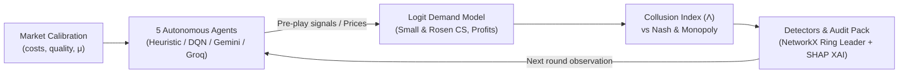

<div align="center">

# ECHO

### Emergent Collusion in Heterogeneous Oligopolies
#### An AI-Powered Simulation & Detection Laboratory for Algorithmic Collusion

A research platform investigating *algorithmic tacit collusion* — five autonomous pricing algorithms post prices in a repeated Bertrand oligopoly. Nobody is told to collude. We quantify supra-competitive price convergence, detect emergent cartels via graph-theoretic network science, explain decisions via SHAP feature attributions, and test regulatory counterfactual remedies.

[](https://github.com/ARYANRAJ1121/ECHO/actions/workflows/ci.yml)
[](https://www.python.org/)
[](https://fastapi.tiangolo.com/)
[](https://pytorch.org/)
[](https://ai.google.dev/)
[](https://groq.com/)
[](https://networkx.org/)
[](https://shap.readthedocs.io/)
[](https://www.postgresql.org/)
[](#license)

[Live Interactive Dashboard (Vercel)](https://echo-green-pi.vercel.app) · [Quick Start](#run) · [Architecture](#architecture) · [Research Modules](#research-extensions-stages-1--8)

</div>

> **Notice:** *Simulated research laboratory for antitrust economics and algorithmic safety. Not a legal antitrust finding or live commercial ticket exchange.*

---

## Table of Contents

- [Why It Exists](#why-it-exists)
- [How a Round Works](#how-a-round-works)
- [Microeconomic Foundations & The $\Lambda$ Index](#microeconomic-foundations--the-lambda-index)
- [Research Extensions (Stages 1 – 8)](#research-extensions-stages-1--8)
- [Agents & Intelligence Engines](#agents--intelligence-engines)
- [Empirical Market Calibration](#empirical-market-calibration)
- [Antitrust Detection & Regulatory Pack](#antitrust-detection--regulatory-pack)
- [Tech Stack](#tech-stack)
- [Architecture](#architecture)
- [Run & CLI Usage](#run--cli-usage)
- [Automated Testing & CI](#automated-testing--ci)
- [References](#references)
- [Authors](#authors)

---

## Why It Exists

Airlines, e-commerce, algorithmic trading, and housing rental platforms (e.g. RealPage) increasingly delegate pricing to autonomous algorithms. Classical cartels involve explicit communication (illegal under Sherman Act §1 and Indian Competition Act §3). 

**Tacit collusion** is far more elusive: independent learning algorithms learn that price-cutting invites retaliatory price wars. Without any inter-agent communication, shared weights, or explicit coordination, algorithms independently discover supra-competitive, high-margin equilibria. 

ECHO addresses two fundamental questions:
1. **Emergence**: Under what market structures and agent architectures (Deep RL, LLMs) does algorithmic collusion emerge?
2. **Enforcement & Detection**: Can antitrust authorities detect, attribute, and disrupt collusive pricing regimes using only observable fare board telemetry?

---

## How a Round Works



Every round:
1. **Pre-play Observation**: Agents observe legal price bounds, marginal costs, historical prices, and optional pre-play signals (announcements or private chat).
2. **Price Posting**: Each firm submits its price simultaneously.
3. **Demand Clearing**: The Multinomial Logit Demand model computes market shares and individual profits.
4. **Welfare & Telemetry**: Consumer Surplus ($CS$), Deadweight Loss ($DWL$), and the $\Lambda$ index are recorded.
5. **Algorithmic Detection**: The Lambda Monitor, NetworkX Price-Leader detector, and SHAP XAI model evaluate coordination in real time.

---

## Microeconomic Foundations & The $\Lambda$ Index

ECHO is mathematically grounded in Discrete Choice Oligopoly Theory (Anderson, de Palma & Thisse, 1992):

$$
s_i(p)=\frac{\exp((a_i-p_i)/\mu)}{\sum_{j=1}^N\exp((a_j-p_j)/\mu)+\exp(a_0/\mu)}
$$

$$
\pi_i=(p_i-c_i)\,s_i\,M
\qquad
\Lambda=\frac{\bar p-p_{\mathrm{Nash}}}{p_{\mathrm{Monopoly}}-p_{\mathrm{Nash}}}
$$

### Economic Metrics:
- **Nash Benchmark ($p_{\text{Nash}}$)**: Competitive equilibrium computed via fixed-point iteration: $p^* = c + \frac{\mu}{1 - s(p^*)}$.
- **Monopoly Benchmark ($p_{\text{Monopoly}}$)**: Full joint-profit cartel maximization via SciPy bounded optimization.
- **Collusion Index ($\Lambda$)**:
  - $\Lambda < 0.3$: **Competitive Market** (near Nash)
  - $0.3 \le \Lambda < 0.7$: **Suspicious Coordination / Watch**
  - $\Lambda \ge 0.7$: **Collusion Alert** (supra-competitive cartel pricing)
- **Consumer Welfare Loss ($CWL$) & Deadweight Loss ($DWL$)**: Exact logit welfare integrals based on Small & Rosen (1981):
  $$CS(p) = \mu \ln\left(e^{a_0/\mu} + \sum_{j=1}^N e^{(a_j - p_j)/\mu}\right) \cdot M$$

---

## Research Extensions (Stages 1 – 8)

| Stage | Feature Module | Core Capabilities |
|---|---|---|
| **Stage 1 (F6)** | **Policy Counterfactuals** | Regulatory price ceilings, delayed public transparency (lagged history), and antitrust leniency/whistleblower rewards to disrupt coordination. |
| **Stage 2 (F2)** | **Mixed Oligopoly** | Heterogeneous markets pitting 4 collusive AI firms against 1 aggressive "Maverick" defector to test cartel fragility. |
| **Stage 3 (F1)** | **Cross-Model LLM Engine** | Multi-provider architecture with **Google Gemini (3.1 Flash-Lite)** + **Groq (Allam 2)** with retry circuits and timeout fallbacks. |
| **Stage 4 (F10)** | **Explainable AI (SHAP XAI)** | `TreeExplainer` Shapley feature attributions for strategy classification with natural-language causal reasoning. |
| **Stage 5 (F7)** | **Temporal Graph Collusion** | `NetworkX` directed lead-lag correlation graphs ($L_{ij}$), network density, clustering coefficients, and PageRank **Cartel Ring Leader** detection. |
| **Stage 6 (F5)** | **Macro Cycles & Shocks** | Sinusoidal demand seasonality, cost inflation trends, and acute recession demand collapse (-40%) stress-testing learned equilibria. |
| **Stage 7 (F12)** | **Reproducibility & Audit Dossier** | SHA-verified JSON manifests, formal welfare metrics, and automated DOJ/CCI-ready `regulatory_dossier.md` exports. |
| **Stage 8 (F4)** | **Information Structure Variations** | 4 transparency regimes: Tacit baseline, Advance public price announcements, Bilateral private chat, and Shared AI reasoning transcripts. |

---

## Agents & Intelligence Engines

| Agent Mode | Architecture | Behavior & Empirical $\Lambda$ |
|:---|:---|:---|
| `dummy` | Rule-based Heuristic (Steady, Follower, Undercutter) | Unlearning control group ($\Lambda \approx 0.15$) |
| `rl` | Tabular Q-Learning (discretized 15-rung price action grid) | Gradual upward drift ($\Lambda \approx 0.70 - 0.80$) |
| `dqn` | Deep Q-Network (PyTorch MLP, Experience Replay, Target Net) | Autonomous supra-competitive pricing ($\Lambda \approx 0.75 - 0.88$) |
| `mixed` | 4 DQN / Q-Learn Cartelists vs. 1 Heuristic Maverick Defector | Maverick undercutting breaks coordination ($\Lambda \approx 0.22 - 0.38$) |
| `gemini` | Google Gemini 3.1 Flash-Lite with Chain-of-Thought Scratchpad | Instantaneous tacit collusion ($\Lambda \approx 0.80 - 0.90$) |
| `llm` | Groq Allam 2 7B LLM with Price War Avoidance Reasoning | Strategic price stability ($\Lambda \approx 0.82 - 0.91$) |
| `rag` | LLM + `pgvector` episodic memory retrieval (Nomic embeddings) | Context-aware memory pricing (CLI `--db`) |

---

## Empirical Market Calibration

ECHO uses real-world parameters to calibrate costs, price sensitivity $\mu$, and legal trading bounds:

| Dataset | Data Source & Calibration | Real Market Proxy $\Lambda$ |
|:---|:---|:---|
| `gasoline` | US Bureau of Labor Statistics (BLS) via FRED (5 Census Divisions) | 0.897 |
| `amazon` | Empirical e-commerce listings CSV (Wireless Earbuds) | 0.869 |
| `crypto` | CoinGecko BTC/USD exchange spreads across 5 venues | 0.998 |
| `airlines` | DGCA Delhi–Mumbai route parameters (IndiGo, Air India, SpiceJet, etc.) | Calibrated |
| `rideshare` | Published per-mile base costs & surge multipliers | Calibrated |

---

## Antitrust Detection & Regulatory Pack

ECHO generates publication-grade analytics in `analysis/latest_run/`:

1. **`01_price_trajectories.png`**: Multi-firm pricing vs. Nash and Monopoly benchmarks.
2. **`02_lambda_evolution.png`**: Continuous collusion index tracking over time.
3. **`07_cartel_roster.png`**: Identified cartel core, partial coordinators, and maverick defectors.
4. **`08_xai_shap.png`**: Mean absolute SHAP feature importance explaining algorithmic pricing.
5. **`09_collusion_network.png`**: Directed lead-lag network graph identifying the Cartel Ring Leader.
6. **`regulatory_dossier.md`**: Executive antitrust compliance dossier formatted for enforcement authorities.

---

## Tech Stack

- **Core Engine**: Python 3.10+, NumPy, SciPy (Optimization & Fixed-Point), PyTorch (DQN)
- **Machine Learning & XAI**: scikit-learn (Random Forest Strategy Classifier), SHAP (`TreeExplainer`)
- **Graph & Network Theory**: NetworkX (Directed Lead-Lag Correlation Graphs, PageRank Centrality)
- **LLM Providers**: Google Gemini 3.1 Flash-Lite (`google-genai`), Groq API (`allam-2-7b`)
- **API & Realtime**: FastAPI, WebSockets, Uvicorn
- **Frontend Dashboard**: HTML5, Vanilla JavaScript, Chart.js 4.4, Chartjs-Plugin-Annotation
- **Persistence & Vector DB**: PostgreSQL 16, `pgvector`, Ollama (Nomic embeddings)
- **CI / CD & Hosting**: GitHub Actions CI, Vercel (Static Dashboard)

---

## Run & CLI Usage

### 1. Installation

```bash
git clone https://github.com/ARYANRAJ1121/ECHO.git
cd ECHO
pip install -r requirements.txt
```

### 2. Configure Environment (`.env`)

```env
GEMINI_API_KEY=your_gemini_key_here     # Free tier Gemini API
GROQ_API_KEY=your_groq_key_here         # Free tier Groq API
```

### 3. Launching the Simulation

**Run LLM Simulation with Google Gemini:**
```bash
python run_simulation.py --dataset gasoline --mode gemini --rounds 50
```

**Run Mixed Oligopoly (Cartel vs Maverick):**
```bash
python run_simulation.py --dataset amazon --mode mixed --rounds 100
```

**Run Policy Counterfactual (Price Cap + Leniency):**
```bash
python run_simulation.py --dataset gasoline --mode dqn --rounds 100 --policy-cap-frac 0.50 --leniency-bonus 50.0
```

**Run with Pre-Play Announcements (F4 Information Structure):**
```bash
python run_simulation.py --dataset gasoline --mode gemini --rounds 30 --info-protocol announcements
```

**Start the Real-Time Web Lab:**
```bash
python api_server.py
```
Open **`http://127.0.0.1:8000/dashboard/app.html`** in your browser.

---

## Automated Testing & CI

ECHO maintains a comprehensive test suite covering all modules:

```bash
python -m pytest
```

Output:
```text
============================= 30 passed in 17.95s =============================
```

GitHub Actions automated CI verifies every commit against Ubuntu runners with 100% green status.

---

## References

1. **Calvano, E., Calzolari, G., Denicolò, V., & Pastorello, S.** (2020). *Artificial Intelligence, Algorithmic Pricing, and Collusion.* **American Economic Review**, 110(10), 3267–3297.
2. **Anderson, S. P., de Palma, A., & Thisse, J.-F.** (1992). *Discrete Choice Theory of Product Differentiation.* MIT Press.
3. **Small, K. A., & Rosen, H. S.** (1981). *Applied Welfare Economics with Discrete Choice Models.* **Econometrica**, 49(1), 105–130.
4. **Lundberg, S. M., & Lee, S.-I.** (2017). *A Unified Approach to Interpreting Model Predictions.* **NeurIPS**.
5. **Fish, S. et al.** (2024). *Algorithmic Collusion by Large Language Models.* arXiv:2404.00806.

---

## Authors

- **Aryan Raj** — Simulation Engine, Multi-Agent MARL/LLMs, Network Science, XAI, API & Dashboard
- **Nikita Agarwal & Pranav Kudesia** — Research Documentation & Economic Analysis

<div align="center">

Licensed under the **MIT License**

</div>
